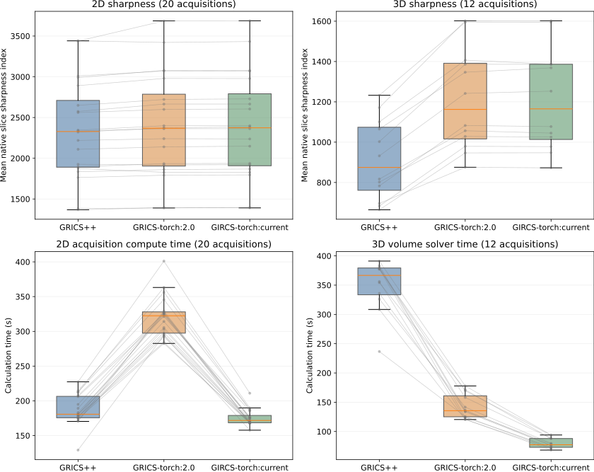
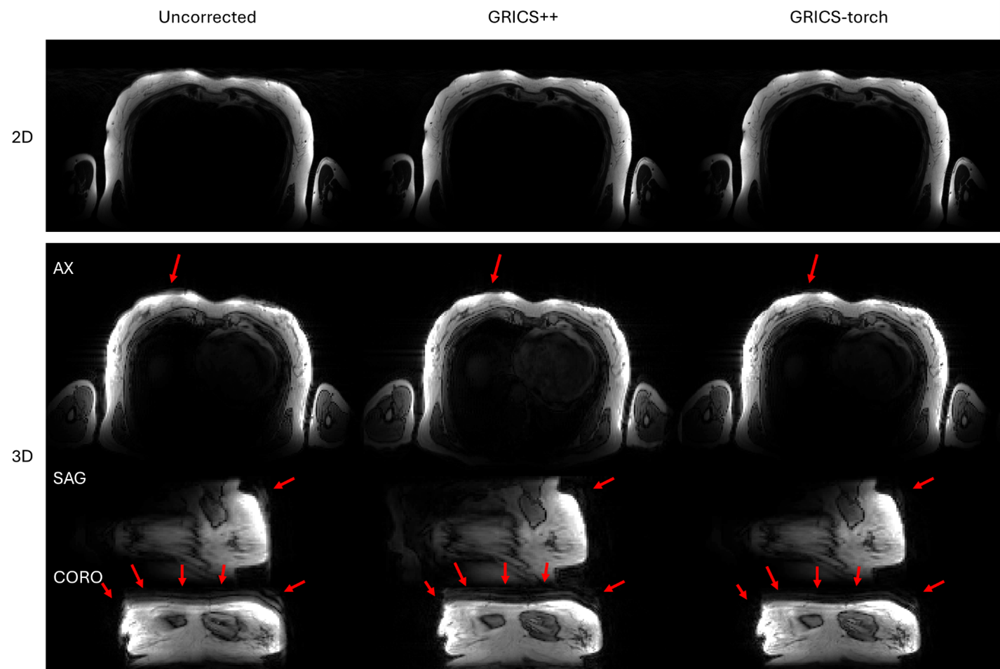

# Comparison of GRICS-torch with GRICS++

In order to ensure that `GRICS-torch` is not inferior to the previously validated `GRICS++` CPU implementation [1, 2] for the breast MRI application, a small validation study was performed.

## Materials and Methods

Two free-breathing supine breast MRI datasets with respiratory belt signals [3] were used: 20 T2-weighted 2D volumes (288 × 475, 60–68 slices) and 12 T1-weighted 3D volumes (160 × 218 × 56). `GRICS-torch` performance was compared with `GRICS++` on a workstation with two AMD EPYC 7F72 24-Core CPUs (96 logical threads), 512 GB RAM, and an NVIDIA A100 PCIe 40 GB GPU. The results were compared in terms of a no-reference sharpness index [4], as well as structural similarity (SSIM) and normalized root mean square error (NRMSE), and computation time.

## Results and Discussion

**Figure 1.** Comparison of GRICS++, `GRICS-torch` 2.0, and the current version of `GRICS-torch` (commit `18a52a304bae76b1070e17abd36a92488d097bf7`) in terms of reconstruction sharpness and computation time for 20 2D and 12 3D acquisitions. The upper panels show the mean slice sharpness index; the lower panels show acquisition compute time for 2D and volume solver time for 3D. Gray lines connect measurements from the same acquisition.

The quantitative results of these comparisons are presented in [Figure 1](#quantitative-comparison), and examples of motion-corrected reconstruction are provided in [Figure 2](#reconstruction-examples). The corrected images were almost identical for the 2D case (SSIM 0.98, NRMSE 0.05) and somewhat different for the 3D case (SSIM 0.92, NRMSE 0.15). However, the sharpness index in [Figure 1](#quantitative-comparison) and the visual evaluation in [Figure 2](#reconstruction-examples) supported the non-inferiority of `GRICS-torch` reconstructions. These discrepancies can be explained by minor implementation differences.

Finally, the newest PyTorch implementation outperformed the GRICS++ in terms of computational time for both 2D and 3D cases, and was substantially faster than GRICS-torch:2.0, as shown in [Figure 1](#quantitative-comparison).

**Figure 2.** Examples of reconstruction using the GRICS++ and `GRICS-torch` algorithms compared with the uncorrected images. The contrast is deliberately exaggerated to highlight the artifacts. The dominant artifact type in the 2D images is blurring, while in the 3D images it is ghosting. Visible ghosting artifacts are indicated by the red arrows. While both versions correct motion artifacts, `GRICS-torch` performed better in this example.

## Conclusion
GRICS-torch is at least as efficient as GRICS++ in terms of non-rigid motion correction for supine breast MRI, and was faster in our hardware configuration.

## References

[1] Odille, F., Menini, A., Escanyé, J. M., Vuissoz, P. A., Marie, P. Y., Beaumont, M., and Felblinger, J. (2015). Joint Reconstruction of Multiple Images and Motion in MRI: Application to Free-Breathing Myocardial T2 Quantification. *IEEE Transactions on Medical Imaging*, 35(1), 197–207.

[2] Zeroual, M. A., Isaieva, K., Vuissoz, P. A., and Odille, F. (2024). Performance study of an MRI motion-compensated reconstruction program on Intel CPUs, AMD EPYC CPUs, and NVIDIA GPUs. *Applied Sciences*, 14(21), 9663.

[3] Isaieva, K., Weber, N., Nohava, L., Fischer, B., Megel, A., Henrot, P., Micard, E., Laistler, E., Felblinger, J., and Odille, F. (2025). Optimal sensor selection for motion-corrected supine breast MRI with a wearable coil. *IEEE Transactions on Biomedical Engineering*, 72(7), 2261–2268. https://doi.org/10.1109/TBME.2025.3539386

[4] Leclaire, A., and Moisan, L. (2015). No-reference image quality assessment and blind deblurring with sharpness metrics exploiting Fourier phase information. *Journal of Mathematical Imaging and Vision*, 52(1), 145–172. https://doi.org/10.1007/s10851-015-0560-5
