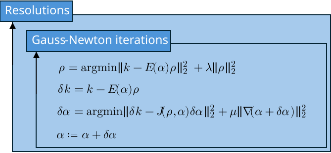

# GRICS reconstruction algorithm

GRICS jointly estimates an image and a motion model from acquired k-space and motion-related signals. Reconstruction proceeds from coarse to fine resolution. At each resolution, Gauss–Newton iterations alternate between reconstructing the image with motion fixed and updating motion from the remaining k-space mismatch. Both linear subproblems are solved with conjugate gradients.

  

## Figure notation

| Symbol | Meaning |
| --- | --- |
| $\rho$ | Reconstructed image shared across motion states. |
| $k$ | Acquired k-space data. |
| $\alpha$ | Motion-model parameters. |
| $E(\alpha)$ | Encoding operator combining motion, coil sensitivities, Fourier transformation, and sampling. |
| $\lambda$ | Image regularization weight. |
| $\delta k = k - E(\alpha)\rho$ | Residual between acquired and predicted k-space. |
| $J(\rho,\alpha) = \frac{\partial [E(\alpha)\rho]}{\partial\alpha}$ | Motion Jacobian mapping a small parameter change to a linearized k-space change. |
| $\mu$ | Motion regularization weight. |
| $\delta\alpha$ | Motion increment, applied as $\alpha \leftarrow \alpha + \delta\alpha$. |
| $\nabla$ | Spatial gradient used to penalize variation in the updated motion field. |

The figure shows non-rigid motion regularization, which encourages a smooth updated field through $\|\nabla(\alpha + \delta\alpha)\|_2^2$. For rigid motion, the solver instead penalizes the increment magnitude $\|\delta\alpha\|_2^2$. Image and motion estimates initialize the next, finer resolution. See [reconstruction architecture](architecture/reconstruction.md) for component responsibilities and state ownership.

## Implementation details

- [JointReconstructor](implementation/joint_reconstructor.md): alternating updates, resolution levels, and regularization normalization.
- [ConjugateGradientSolver](implementation/conjugate_gradient_solver.md): linear solves, probe scaling, and stopping criteria.
- [EncodingOperator](implementation/encoding_operator.md): forward/adjoint encoding and the optimized normal operator.
- [MotionOperator](implementation/motion_operator.md): rigid and non-rigid coordinates, interpolation, and boundaries.
- [MotionPerturbationSimulator](implementation/motion_perturbation_simulator.md): motion Jacobian approximation and image gradients.
- [PseudoGaussSeidelMotionPreconditioner](implementation/motion_preconditioner.md): local motion-system approximation and triangular solves.
- [CoilSensitivityCalculator](implementation/coil_sensitivity_calculator.md): coil calibration, smoothing, and map normalization.
- [MotionBinner](implementation/motion_binner.md): physiological state grouping and k-space energy selection.
- [MotionSimulator](implementation/motion_simulator.md): synthetic motion curves, displacement fields, and corrupted acquisitions.
