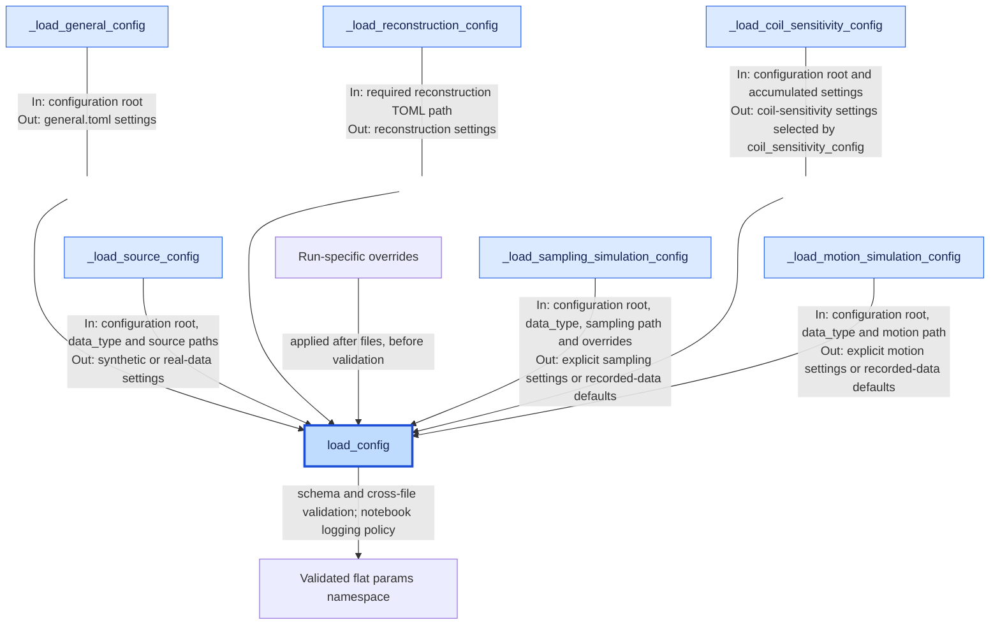

# Configuration architecture

`src/runtime/runtime_config.py` is the shared configuration boundary for
notebooks, pipelines, and applications.

## Data flow

Blue nodes are Python functions; uncolored nodes are parameters or outputs.
`In` and `Out` describe each helper's inputs and returned settings.
`load_config` merges general, reconstruction, coil-sensitivity, source,
sampling, and motion settings in that order. It passes the accumulated settings
to the coil-sensitivity helper; helpers do not call one another to transfer them.

## Configuration boundaries

Schemas and cross-file checks live in `runtime_config.py`. Preprocessing and
reconstruction receive `params`; they do not read TOML files themselves.
Validation of actual acquisition dimensions happens after data loading.

Only keys in the override allowlist can replace file values. Invalid explicit
files or incompatible combinations raise errors. Motion includes share settings
without overriding them: included and selecting files cannot define the same
key, and includes must remain below the including directory without cycles.

Automatic files resolve relative to the repository's `config/` directory.
Caller-supplied paths resolve relative to the working directory unless absolute.

`load_postprocessing_config(...)` validates a separate namespace owned by the
pipeline. `initialize_runtime(params)` then handles device selection and run
state independently of configuration loading.

File choices and usage examples are in the
[configuration guide](../usage/configuration.md).
