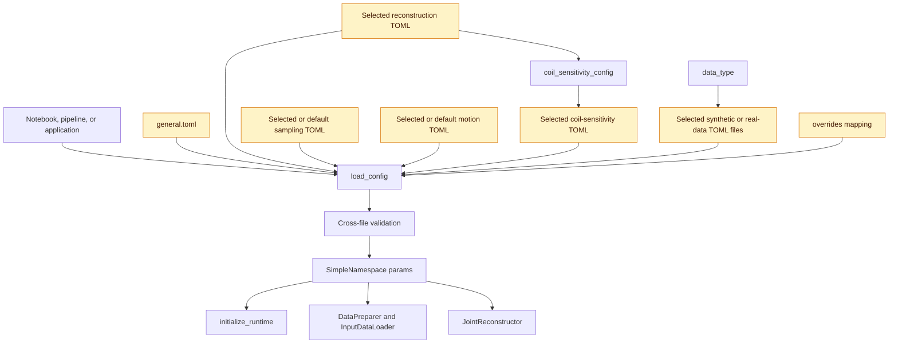

# Configuration architecture

The configuration system assembles one validated runtime namespace from small
TOML files. Each file owns one concern: runtime behavior, input generation,
acquisition sampling, motion simulation, coil sensitivity estimation, or
reconstruction. Entry points select only the files needed for their workflow;
`src/runtime/runtime_config.py` loads and validates the complete combination.

## Configuration layout

```text
config/
├── general.toml
├── coil_sensitivity/
│   ├── espirit.toml
│   └── odille_spline.toml
├── reconstruction/
│   ├── rigid_2d.toml
│   ├── rigid_3d.toml
│   ├── nonrigid_2d.toml
│   ├── nonrigid_2d_breast.toml
│   ├── nonrigid_3d.toml
│   └── nonrigid_3d_breast.toml
├── synthetic_data/
│   ├── from_image.toml
│   ├── shepp_logan_2d.toml
│   └── shepp_logan_3d.toml
├── real_data/
│   ├── ismrmrd_reader.toml
│   ├── saec.toml
│   ├── polaris.toml
│   ├── physio_text.toml
│   └── physio_array.toml
├── sampling_simulation/
│   ├── from_data.toml
│   ├── linear.toml
│   ├── interleaved.toml
│   └── random.toml
├── motion_simulation/
│   ├── as_is.toml
│   ├── rigid_per_readout_{2d,3d}.toml
│   ├── rigid_per_shot_{2d,3d}.toml
│   ├── nonrigid_per_readout_{2d,3d}.toml
│   ├── nonrigid_per_shot_{2d,3d}.toml
│   └── common/
│       ├── rigid_2d_common.toml
│       ├── rigid_3d_common.toml
│       └── nonrigid_common.toml
└── postprocessing/
    └── nonrigid_2d_breast.toml
```

The TOML table identifies the file's owner. For example, reconstruction files
use `[reconstruction]`, sampling files use `[sampling]`, and motion files use
`[motion]`. `general.toml` is the only multi-table file; it contains `[paths]`,
`[runtime]`, and `[kspace_normalization]`.

| Directory or file | Owns | Selection |
| --- | --- | --- |
| `general.toml` | output paths, runtime flags, seeding, k-space normalization | automatic |
| `reconstruction/` | reconstruction model, motion binning, resolution levels, regularization, solvers | explicit and required |
| `coil_sensitivity/` | ESPIRiT or Odille-spline parameters | automatic from the reconstruction file |
| `synthetic_data/` | source dimensions and phantom/image generation | explicit for synthetic data |
| `real_data/` | raw MRI reader and physiological-reader settings | selected by `data_type` |
| `sampling_simulation/` | recorded or simulated acquisition order | explicit, except recorded real data |
| `motion_simulation/` | recorded, per-readout, or per-shot motion | explicit, except recorded real data |
| `postprocessing/` | pipeline-specific image postprocessing | loaded separately |

## Load flow



`load_config(...)` performs these steps in order:

1. Load `config/general.toml` from the repository configuration root.
2. Add the caller's `data_type` and load the required
   `reconstruction_config`.
3. Read `coil_sensitivity_config` from the reconstruction settings and
   automatically load `espirit.toml` or `odille_spline.toml`.
4. Load the source configuration selected by `data_type`.
5. Load the requested sampling and motion configurations, or the real-data
   defaults described below.
6. Apply the caller's `overrides` mapping.
7. Validate individual values and dependencies across all selected files.
8. Apply notebook logging policy and return the flattened settings as a
   `SimpleNamespace`.

All configuration values are therefore accessed as attributes such as
`params.Nex`, `params.simulated_motion_type`, and
`params.reconstruction_motion_type`; the original TOML table nesting is not
preserved in the returned object.

Repository-owned automatic files are resolved from the `config/` directory next
to the source tree. Paths passed as function arguments follow normal `Path`
semantics, so entry points may supply paths relative to their working directory
or absolute paths.

### Loader responsibilities

The loading code is separated into small functions in
`src/runtime/runtime_config.py`:

- `_load_toml_flat(...)` parses one TOML, enforces its table/key schema, expands
  a motion include, and returns flat key/value pairs;
- `_load_source_config(...)` selects synthetic or real-data files from
  `data_type`;
- `_load_sampling_simulation_config(...)` and
  `_load_motion_simulation_config(...)` select explicit files or real-data
  defaults;
- `_apply_overrides(...)` applies only keys listed as overridable;
- the `_validate_*` functions enforce local and cross-file constraints; and
- `load_config(...)` coordinates those stages and constructs the final
  namespace.

This central path ensures notebooks, pipelines, and external applications use
the same schemas and compatibility checks.

## File selection by data type

The `data_type` argument decides which source settings are valid and required.

### Synthetic inputs

- `shepp-logan` requires `shepp_logan_config`.
- `from_image` requires `from_image_config`.
- Both require an explicit `sampling_config` and
  `motion_simulation_config`.

For example:

```python
from src.runtime.runtime_config import load_config

params = load_config(
    data_type="shepp-logan",
    reconstruction_config="config/reconstruction/rigid_3d.toml",
    shepp_logan_config="config/synthetic_data/shepp_logan_3d.toml",
    sampling_config="config/sampling_simulation/interleaved.toml",
    motion_simulation_config="config/motion_simulation/rigid_per_readout_3d.toml",
    overrides={"runtime_device": "cpu"},
)
```

### Real inputs

`preprocessed-real` needs no reader-specific TOML. ISMRMRD and Siemens raw
inputs require `ismrmrd_reader_config`. Additional physiological settings depend
on the suffix of `data_type`:

- `*-saec` requires `real_data_config`, normally `real_data/saec.toml`;
- `*-polaris` requires `polaris_config`;
- `*-physio_text` and `*-physio_array` automatically load the matching file
  from `real_data/`, unless `physio_config` supplies another path.

When a real-data call omits `sampling_config`, the loader selects
`sampling_simulation/from_data.toml`. When it omits
`motion_simulation_config`, it selects `motion_simulation/as_is.toml`. These
defaults preserve the recorded acquisition order and motion signal.

Selecting simulated sampling for real data requires an explicit sampling file.
Because `as-it-is` motion is valid only with recorded sampling, a resampled
real-data workflow must also select a synthetic motion configuration explicitly.
The loader reports incompatible combinations rather than silently changing
them.

## Motion configuration includes

Only a `[motion]` table may declare `include`. The value is one nonempty path
relative to the including file:

```toml
[motion]
include = "common/nonrigid_common.toml"
motion_simulation_config_dimension = "2D"
simulated_motion_type = "non-rigid-per-readout"
nonrigid_motion_amplitude = 2.0
nonrigid_resp_cycles_min = 6
nonrigid_resp_cycles_max = 7
```

Included values are loaded before the selecting file. An include cannot use an
absolute path or `..`, include cycles are rejected, and the selecting file
cannot redefine a key supplied by the included file. This makes the common
spatial or geometric model explicit while keeping mode-specific parameters in
the selected configuration.

## Schemas, overrides, and validation

`runtime_config.py` defines the allowed table and key set for every file type.
Loading fails for unknown tables, misplaced keys, invalid value types, or
missing required settings. Cross-file validation then checks relationships such
as:

- data, reconstruction, and motion dimensionality matching;
- source-specific files matching `data_type`;
- motion parameters matching the selected simulation mode;
- shot counts and sampling sizes being consistent;
- reconstruction state counts matching resolution levels; and
- coil-sensitivity and reconstruction options being compatible.

The `overrides` mapping is applied after every main configuration file has been
loaded, so an allowed override has the highest precedence. Overrides are meant
for run-specific values such as the device, output location, state count, or
debug flags. Unknown and non-overridable keys are rejected. In particular, the
coil-sensitivity implementation is selected in the reconstruction TOML rather
than replaced through `overrides`.

There is no implicit fallback for an invalid or missing explicit configuration.
The only automatic choices are the documented general, coil-sensitivity, and
real-data defaults.

## Separate postprocessing configuration

Postprocessing settings are intentionally outside `load_config(...)` because
they belong to a specific pipeline rather than the shared reconstruction
runtime. A pipeline loads them with:

```python
from src.runtime.runtime_config import load_postprocessing_config

postprocessing = load_postprocessing_config(
    "config/postprocessing/nonrigid_2d_breast.toml"
)
```

`load_postprocessing_config(...)` applies its own schema, optional overrides,
and validation, then returns a separate `SimpleNamespace`.

## Runtime consumers

Entry points pass the resolved `params` object through the complete workflow:

- `initialize_runtime(params)` selects devices and establishes runtime state;
- `InputDataLoader` uses source, sampling, and reader settings;
- `DataPreparer` uses normalization, coil-sensitivity, motion-simulation, and
  motion-binning settings; and
- `JointReconstructor` uses reconstruction, regularization, and solver settings.

`initialize_runtime(params)` creates the run output manager and writes the
resolved settings to `config_resolved.json`. The snapshot preserves the
effective configuration, including explicit overrides, rather than only the
individual source TOMLs. Entry points use `managed_execution` to finalize that
run metadata and release runtime resources on success or failure.

## Extension rules

When adding configuration:

1. Put each setting in the TOML family that owns the behavior.
2. Add the key to the matching schema in `runtime_config.py`.
3. Add type, range, and cross-file validation close to the existing validator
   for that family.
4. Add the key to `_OVERRIDE_KEYS` only when callers should be allowed to
   change it per run.
5. Pass new config paths explicitly from entry points unless their selection is
   an unambiguous consequence of an existing selector such as `data_type`.

Do not read TOML files directly inside preprocessing or reconstruction classes.
Those classes should consume the validated `params` namespace so every entry
point follows the same loading and validation path.
