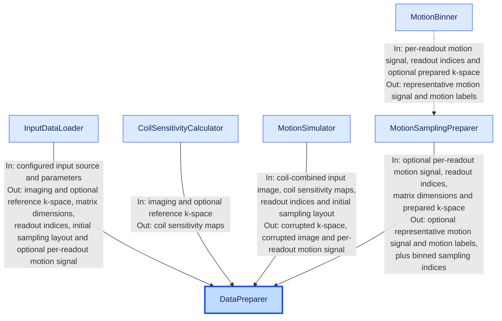

# Data preparation architecture

The data preparation path transforms one loaded acquisition slice or volume
into the tensors and sampling metadata consumed by reconstruction. Loading and
file-format handling belong to `InputDataLoader`; `DataPreparer` owns the
reconstruction-specific work that begins after an input is active.

## Data flow



`DataPreparer` owns every transfer between preparation stages. Each arrow lists
the data received and returned by its source class. Solid arrows connect data
returned to `DataPreparer`; the dashed arrow is the one internal relationship:
`MotionSamplingPreparer` uses `MotionBinner` to assign motion states.

`MotionSimulator` participates only when simulated motion is configured. For
recorded data, `InputDataLoader` supplies the synchronized per-readout motion
signal. For simulation, `MotionSimulator` supplies a scalar per-readout motion
signal. `DataPreparer` passes that signal to `MotionSamplingPreparer` together
with the chronological readout indices and prepared k-space.

Here, readout indices are the chronological `ky`, optional `kz`, and repetition
indices. The initial sampling layout groups those readouts before simulated
motion is applied. Binned sampling indices are the flattened spatial indices,
grouped by repetition and motion state, that preparation ultimately produces.
Prepared k-space is the normalized loaded k-space for recorded motion or the
corrupted k-space returned by `MotionSimulator` for simulated motion.

## Responsibilities

### `DataPreparer`

`DataPreparer` coordinates preparation for one active slice or volume. It:

- requires the acquisition to be loaded before preparation starts;
- selects one slice for a 2D real-data acquisition and validates its dimensions;
- optionally normalizes imaging and reference k-space with one shared scale;
- calculates coil sensitivity maps and a coil-combined input image;
- imports recorded motion or simulates motion and replaces its working k-space;
- bins chronological readouts into motion states;
- builds the flattened sampling indices used by the encoding operator; and
- prepares optional images and motion metadata for diagnostics.

It does not parse source files, synchronize MRI and physiological timestamps, or
run the reconstruction solver. Those responsibilities belong to the loading
path and `JointReconstructor` respectively.

The tensors copied from `InputDataLoader` are initially shared. Normalization or
motion simulation may replace `DataPreparer.kspace`, but does not modify the
complete acquisition retained by the loader.

### `CoilSensitivityCalculator`

`CoilSensitivityCalculator` owns coil sensitivity map estimation. It supports
ESPIRiT and ODILLe-style spline sensitivity maps. ESPIRiT uses reference k-space
when it is available; otherwise it averages the repetitions of the imaging
k-space. The spline method uses the imaging k-space and also exposes the
normalized GRICS reference image used by optional pipeline postprocessing.

### `MotionSimulator`

`MotionSimulator` applies configured rigid or non-rigid motion per shot or per
readout. It returns corrupted k-space, an uncorrected image, and the simulated
per-readout motion signal used for binning. Per-readout simulations build their
motion operators on the CPU to avoid retaining one sparse warp per readout on
the GPU.

Recorded-motion mode (`simulated_motion_type = "as-it-is"`) bypasses this class:
the synchronized per-readout motion signal in `motion_data` is binned directly
and the coil-combined input image becomes `image_no_moco`.

### `MotionBinner`

`MotionBinner` assigns one motion-state label to every chronological readout and
returns one representative motion signal value per state. The supported
strategies are `kmeans` and `kspace_energy`. Energy-based binning quantizes the
motion signal features, selects high-energy virtual times as state
representatives, and requires the prepared k-space.

Both strategies reject a constant motion signal. The configured number of
motion states cannot exceed the available motion signal samples; energy-based
binning also cannot request more states than the number of quantized virtual
times.

### `MotionSamplingPreparer`

`MotionSamplingPreparer` combines chronological acquisition indices with the
motion labels. It groups `ky` and, for 3D data, paired `kz` values into the
nested layout `[Nex][Nmotion]`. Each phase-encoding readout is then expanded
over all `kx` positions and flattened in `[kx, ky, kz]` tensor order for the
encoding operator.

When no motion signal is present, each recorded readout remains its own motion
state within its repetition. Named Boolean sampling masks are supported for the
external preparation API; masks remove readouts without changing their shared
motion labels.

## Main data shapes

The selected imaging k-space and estimated coil sensitivity maps use:

```text
kspace:            [Ncoil, Nex, Nx, Ny, Nz]
smaps:              [Ncoil, Nx, Ny, Nz]
input_ifft_image:   [Nx, Ny] for 2D, [Nx, Ny, Nz] for 3D
```

Motion and chronological acquisition metadata use:

```text
motion_data:       [Nreadout, Nsensor] (per-readout motion signal)
motion_labels:     [Nreadout]
motion_signal:     [Nmotion, Nsensor] (representative motion signal)
chronological_ky:  [Nreadout]
chronological_kz:  [Nreadout] for 3D, otherwise None
chronological_nex: [Nreadout]
```

The binned and flattened layouts are nested Python lists:

```text
binned_ky_indices:  [Nex][Nmotion] of variable-length tensors
binned_kz_indices:  [Nex][Nmotion] of variable-length tensors, or None
sampling_idx:       [Nex][Nmotion] of flattened spatial indices
```

An empty motion state has an empty sampling tensor. This preserves a rectangular
`[Nex][Nmotion]` layout without inventing samples.

## Lifecycle

`DataPreparer` has a two-step lifecycle:

```python
data = DataPreparer(params, sp_device=sp_device, t_device=device, filename=files)
data.load_input_data()
data.prepare_reconstructor_inputs(slice_idx=slice_idx)
```

`load_input_data()` delegates to `InputDataLoader` and can load a complete
multi-slice acquisition once. `prepare_reconstructor_inputs()` activates one
requested 2D slice, or retains the complete 3D volume, and prepares it exactly
once. Calling preparation before loading or calling it twice on the same
instance raises `RuntimeError`.

For multi-slice processing, callers shallow-copy the loaded `DataPreparer` and
prepare a different slice in each copy. Slice selection also shallow-copies the
shared loader before changing its active data, so the original complete
acquisition remains reusable.

## Normalization and motion paths

When `normalize_kspace` is enabled, `DataPreparer` divides k-space by either its
maximum magnitude or its root-mean-square magnitude. The divisor is clamped by
`kspace_norm_eps`, stored in `kspace_scale`, and also applied to reference
k-space. When normalization is disabled, `kspace_scale` remains `1.0`.

The preparation then follows one of two motion paths:

| Configuration | K-space passed to reconstruction | Per-readout motion signal passed to binning |
| --- | --- | --- |
| `simulated_motion_type = "as-it-is"` | normalized loaded k-space | synchronized recorded `motion_data` |
| rigid or non-rigid simulation | simulated corrupted k-space | simulated per-readout motion signal |

Only simulated workflows expose the uncorrupted coil-combined input as
`image_ground_truth`. Non-rigid simulation may additionally expose ground-truth
deformation coefficient maps.

## Public external preparation API

`GRICSPreparerAPI` provides the motion-binning and sampling-layout part of this
pipeline to applications that already own their acquisition arrays. Its
constructor loads and validates configuration and initializes the runtime once.
`prepare_acquisition(...)` accepts a per-readout motion signal and chronological
`ky`, `kz`, and repetition indices, then returns an immutable
`PreparedGRICSAcquisition`.

This API is intentionally limited to recorded metadata: configuration must use
`kspace_sampling_type = "from-data"` and
`simulated_motion_type = "as-it-is"`. It does not load MRI files, estimate coil
sensitivity maps, simulate motion, or create an acceleration pattern. Optional
named masks must be Boolean selections with one value per readout; the caller
owns the meaning and construction of those selections.

The returned object contains the resolved parameters, representative motion
signal, per-readout motion labels, named `[Nex][Nmotion]` sampling layouts, and
the chronological acquisition indices. Supplying `seed` makes stochastic
k-means initialization reproducible without changing the caller's random-number
generator state outside the operation.

## Diagnostic outputs

When `save_debug_plots` is enabled, preparation can write the recorded sampling
order, clustered motion plots, the uncorrected image, simulated ground truth,
and non-rigid coefficient plots to `initial_data_folder`. It also constructs
`motion_plot_context`, which carries chronological indices, labels, display
limits, and optional non-rigid visualization scales into reconstruction plots.

Diagnostics are optional side effects. The reconstruction contract is the
prepared tensors and sampling layout, not the generated figures.

## Extension rules

When adding a preparation stage, keep source-format behavior in the loading
path and solver behavior in reconstruction. `DataPreparer` should coordinate
components rather than absorb their algorithms.

New motion-binning strategies belong in `MotionBinner` and must return one label
per chronological readout plus one representative motion signal per state. New
sampling layouts belong in `MotionSamplingPreparer` and must preserve the
`[Nex][Nmotion]` contract expected by `EncodingOperator`.

Configuration must be loaded and validated before constructing these classes.
Preparation components consume the resolved `params` namespace and should not
read TOML files directly.
