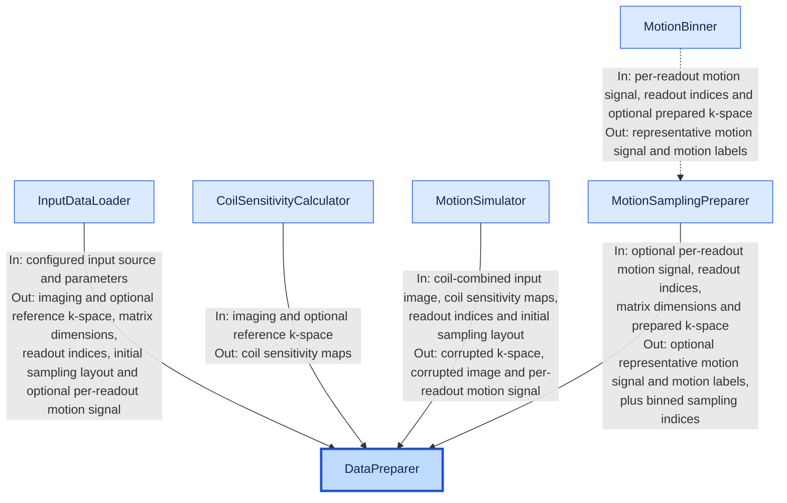

# Data preparation architecture

`DataPreparer` coordinates reconstruction preparation for one loaded slice or
volume. Source loading belongs to [InputDataLoader](input_data_loading.md).

## Data flow

`In` and `Out` refer to the source class of each arrow. `DataPreparer` passes
inputs to each helper and collects its outputs; helpers do not transfer data
directly to one another. The dotted edge is internal delegation from
`MotionSamplingPreparer` to `MotionBinner`.

## Preparation state

Loading and preparation are separate phases. `load_input_data()` must precede
`prepare_reconstructor_inputs(...)`, which can succeed only once per preparer.
Multi-slice pipelines copy the loaded preparer and its parameters for each
slice; preparation copies the loader before selecting that slice.

Tensors initially share the loader's storage. Normalization and simulation
replace the preparer's working k-space without modifying the retained
acquisition. Imaging and reference k-space use the same normalization divisor,
stored in `kspace_scale` for reconstruction.

`DataPreparer` computes the coil-combined input image from repetition-averaged
k-space and the estimated coil sensitivity maps. Recorded motion bypasses
`MotionSimulator`; simulation replaces the working k-space and per-readout
motion signal. Only simulation treats the input image as ground truth.

## Sampling contract

Readout indices are chronological `ky`, optional `kz`, and repetition indices.
The initial sampling layout groups readouts for simulation. Binned sampling
indices expand each readout over `kx` and flatten in `[kx, ky, kz]` order.

The per-readout motion signal has shape `[Nreadout, Nsensor]`; the representative
`motion_signal` has shape `[Nmotion, Nsensor]`. The final `sampling_idx` is a
nested `[Nex][Nmotion]` list of variable-length tensors. Empty states retain
empty tensors so repetitions share the same state layout.

Without a motion signal, each readout becomes its own state within its
repetition; labels and the representative signal are absent. Energy-based
binning additionally requires prepared k-space.

`GRICSPreparerAPI` reuses `MotionSamplingPreparer` for applications that already
own their acquisition arrays. API usage is in the
[README](../../Readme.md#data-preparation-api).
