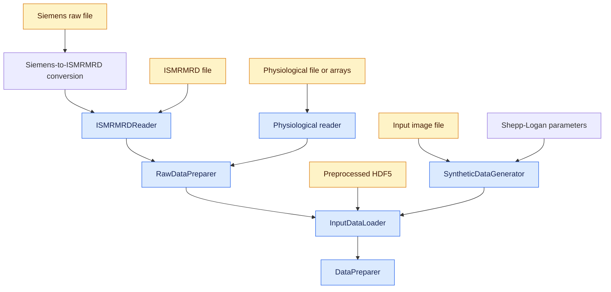

# Input data loading architecture

The loading path converts every source into one acquisition interface before
reconstruction-specific preparation.

## Data flow

Blue nodes are Python classes. Amber nodes are input files. Uncolored nodes are
parameters, processing steps, or outputs.

## Ownership boundaries

MRI and physiological readers decode their own formats. Physiological readers
also own filtering, channel selection, and synchronization policy;
`RawDataPreparer` performs the actual alignment to MRI readout timestamps,
normalizes the aligned motion signal, and optionally caches the complete acquisition.

Synchronization precedes slice selection. `RawDataPreparer` always returns the
complete acquisition; `InputDataLoader` owns activation of a 2D slice or the
complete 3D volume. A workflow using generated sampling loads MRI data without
physiology and replaces the recorded sampling order.

## Acquisition lifetime

`InputDataLoader._input_*` retains the complete acquisition. Its public
attributes (`kspace`, `motion_data`, `ky_idx`, `kz_idx`, and `nex_idx`)
describe the active slice or volume. Selecting a 2D slice retains a singleton
spatial `z` axis and flattens motion and indices into chronological readouts;
3D keeps the full volume.

`DataPreparer.load_input_data()` loads once, and
`prepare_reconstructor_inputs(...)` requests slice selection before
[reconstruction preparation](data_preparation.md). This separation lets
multi-slice pipelines reuse the acquisition without reading source files again.

Input formats and stored array shapes are in the
[input data guide](../usage/input_formats.md).
