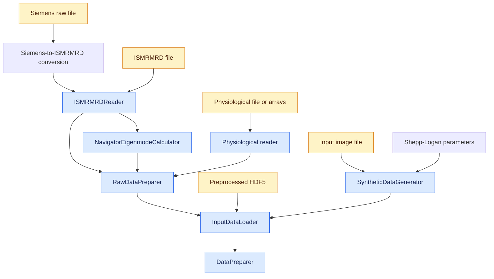

# Input data loading architecture

The loading path converts every source into one acquisition interface before reconstruction-specific preparation.

## Data flow

Blue nodes are Python classes. Amber nodes are input files. Uncolored nodes are parameters, processing steps, or outputs.

## Ownership boundaries

MRI and physiological readers decode their own formats. Physiological readers also own filtering, channel selection, and synchronization policy; `RawDataPreparer` performs the actual alignment to MRI readout timestamps, normalizes the aligned motion signal, and optionally caches the complete acquisition.

For navigator sources, `ISMRMRDReader` dispatches extraction by `navigator_type` and owns navigator identification, contrast selection, and exclusion of navigator readouts from imaging tensors. `NavigatorEigenmodeCalculator` owns profile processing, non-rigid registration, and temporal SVD. Its physiological-reader interface consumes decoded MRI records instead of an external file. `RawDataPreparer` supplies those records and retains ownership of synchronization, normalization, and caching. A pipeline may pass an in-memory navigator reference through `DataPreparer` and `InputDataLoader`; the calculator verifies navigator samples, scanner timestamps, extraction indices, and settings before reusing registration and modes. Each contrast still owns its synchronization and normalization. Navigator and imaging set selection are independent, allowing a shared navigator source for both contrasts. Navigator times preserve the MRI clock and are not independently shifted to the last navigator measurement. Source-specific settings and supported acquisition layouts are described in the [input data guide](../usage/configuration/input_formats.md#ismrmrd-navigators-and-siemens-navigators).

Synchronization precedes slice selection. `RawDataPreparer` always returns the complete acquisition; `InputDataLoader` owns activation of a 2D slice or the complete 3D volume. A workflow using generated sampling loads MRI data without physiology and replaces the recorded sampling order.

## Acquisition lifetime

`InputDataLoader._input_*` retains the complete acquisition. Its public attributes (`kspace`, `motion_data`, `ky_idx`, `kz_idx`, and `nex_idx`) describe the active slice or volume. Selecting a 2D slice retains a singleton spatial `z` axis and flattens motion and indices into chronological readouts; 3D keeps the full volume.

Constructors configure the input source without selecting a slice. `DataPreparer.load_input_data()` loads the complete acquisition once, and `prepare_reconstructor_inputs(slice_idx=...)` requests 2D slice selection before [reconstruction preparation](data_preparation.md). This separation lets multi-slice pipelines reuse the acquisition without reading source files again.

Input formats and stored array shapes are in the [input data guide](../usage/configuration/input_formats.md).
