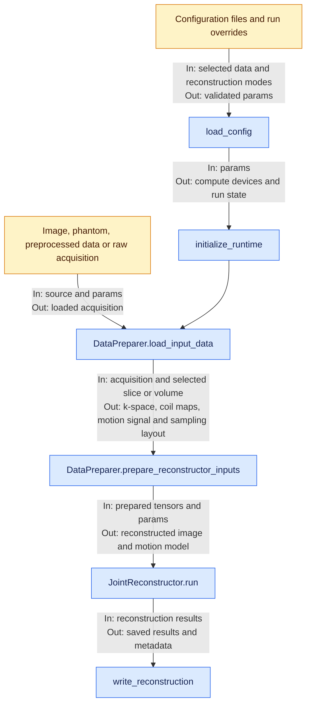
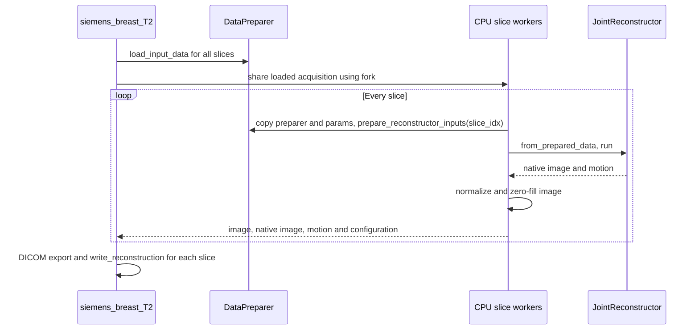

# Pipeline architecture

The basic pipeline follows the same reconstruction stages as the demos. Acquisition-specific 2D and 3D pipelines are preimplemented for workflows that also need input selection, parallel execution, postprocessing, or DICOM export.

## Basic pipeline



Blue nodes are Python functions or class methods. Amber nodes are user-selected inputs. `In` and `Out` describe each stage's inputs and returned state.

Source-specific behavior is contained in `DataPreparer`. `JointReconstructor` receives the shared interface and does not load configuration or input data; the notebook or pipeline owns workflow postprocessing and export.

See [configuration](architecture/configuration.md), [input loading](architecture/input_data_loading.md), [data preparation](architecture/data_preparation.md), and [reconstruction](architecture/reconstruction.md) for component boundaries.

## Standard reconstruction

After loading the configured parameters, initialize the runtime, load the acquisition, and prepare the selected slice or volume:

```python
from src.reconstruction.JointReconstructor import JointReconstructor
from src.preprocessing.DataPreparer import DataPreparer
from src.runtime.runtime_setup import initialize_runtime

runtime = initialize_runtime(params)
data = DataPreparer(params=params, runtime=runtime, filename=input_file)
data.load_input_data()
data.prepare_reconstructor_inputs()
reconstructor = JointReconstructor.from_prepared_data(data)
image, motion_model = reconstructor.run()
```

Omit `filename` for Shepp–Logan data. The returned `Runtime` contains `sp_device` for SigPy and `t_device` for PyTorch; `DataPreparer` passes each device to the components that need it. The two backends can use different devices, and runtime setup announces any CPU fallback.

`from_prepared_data(data)` supplies the prepared tensors, configuration, plotting context, calibration image when enabled, and encoded voxel spacing. `run()` executes the configured multi-resolution reconstruction and restores the acquisition intensity scale. The returned image, `data.image_no_moco`, and simulated `data.image_ground_truth` therefore use the same units. Working k-space and `data.input_ifft_image` remain in preprocessing units.

For 2D real data, select the target with `prepare_reconstructor_inputs(slice_idx=...)` after loading. For an acquisition containing several slices, prepare a separate copy of the loaded preparer and its parameters for each slice. See [using DataPreparer](usage/data_preparer.md) for the full preparation sequence, [using JointReconstructor](usage/joint_reconstructor.md) for the solver calls, the demos for complete configuration and runtime setup, and the [output guide](usage/outputs.md) for saving results.

## Preimplemented pipelines

`siemens_breast_T2.py` and `siemens_breast_3d_lowres.py` accept a Siemens `.dat` file and its SAEC physiological file. Both use the same explicit configuration, runtime, preparation, reconstruction, and export calls as the demos. Siemens-to-ISMRMRD conversion remains part of input loading.

### Shared boundaries

`run_pipeline(...)` owns configuration and execution order. `JointReconstructor.from_prepared_data(data)` and `run()` are called directly. `write_reconstruction(...)` saves final tensors and metadata; both pipelines always export DICOMs using the acquisition geometry. `@managed_execution` finalizes the manifest and releases resources.

Both scripts take `raw_data_file`, `saec_file`, `--output-root`, `--dicom-header-dir`, and `--dicom-series-number`. The 2D pipeline runs all slices on CPU; the 3D pipeline uses its configured compute device.

### 2D T2 pipeline



`pipelines/utils/parallel.py` owns worker setup and NumPy result transport. Results retain acquisition slice order. Each worker's preparer and parameter copies share the loaded acquisition but own their slice selection and output paths. Only CPU execution is supported. Final exports begin after all slices succeed.

`pipelines/utils/postprocessing.py` owns reference-image normalization and header-based zero-filling and cropping for both pipelines.

### 3D low-resolution pipeline

The 3D pipeline prepares and reconstructs the complete volume in one process, then optionally normalizes the image by the GRICS reference and zero-fills/crops it to the header's 3D reconstruction matrix before exporting the final DICOM series and saving the final and native tensors. See [postprocessing](usage/postprocessing.md) for the image steps.

Output names, flags, and cache lifetime are documented in the [output guide](usage/outputs.md).
