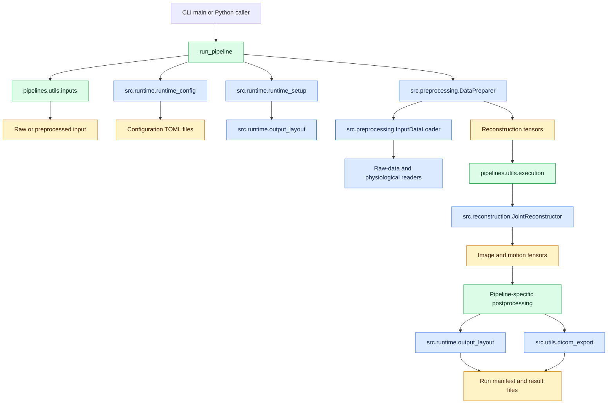
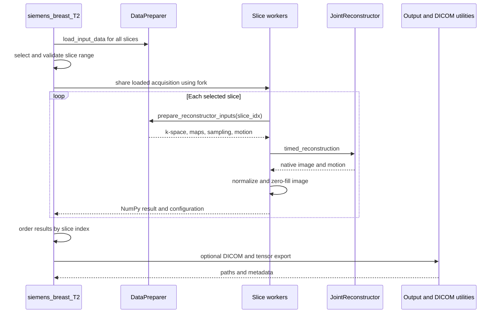
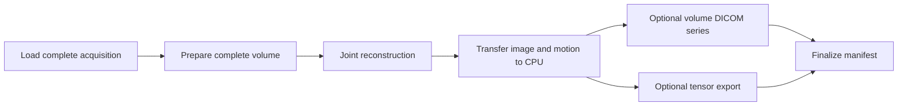

# Pipeline architecture

The `pipelines/` package provides executable entry points for complete breast
MRI reconstructions. Pipeline code selects inputs and configuration, coordinates
the shared preprocessing and reconstruction components, applies workflow-specific
postprocessing, and exports final results. The underlying MRI algorithms remain
in `src/` and can also be used by notebooks or other applications.

## Package layout

```text
pipelines/
├── siemens_breast_T2.py
├── siemens_breast_3d_lowres.py
└── utils/
    ├── __init__.py
    ├── execution.py
    └── inputs.py
```

`siemens_breast_T2.py` reconstructs selected slices of a multi-slice 2D T2
acquisition. `siemens_breast_3d_lowres.py` reconstructs one complete low-resolution
3D volume. The modules in `pipelines/utils/` contain behavior shared by both
entry points; they are pipeline helpers rather than general reconstruction code.

## System interaction



Green nodes are pipeline-owned orchestration. Blue nodes are shared components
from `src/`. Amber nodes are configuration, data, or output artifacts.

## Common lifecycle

Both entry points expose a `run_pipeline(...)` function for Python callers and a
`main(...)` function for command-line use. The command-line layer only parses
arguments, calls `run_pipeline(...)`, and prints a short result summary.

`run_pipeline(...)` follows the same high-level lifecycle in both workflows:

1. `resolve_input_files(...)` selects the preferred preprocessed file or the raw
   MRI and SAEC pair.
2. `data_type_from_raw_data_file(...)` maps the selected files to the data type
   expected by `load_config(...)`.
3. `load_config(...)` combines the reconstruction, general, coil-sensitivity,
   raw-data, and runtime settings. `reconstruction_overrides(...)` supplies the
   pipeline output path, device, logging policy, and other fixed script settings.
4. `initialize_runtime(...)` selects Torch and SigPy devices and creates a
   `RunOutputs` instance for the run.
5. `DataPreparer.load_input_data()` asks `InputDataLoader` to load either a
   preprocessed HDF5 file or a raw acquisition through the shared readers.
6. `DataPreparer.prepare_reconstructor_inputs(...)` normalizes k-space, prepares
   coil sensitivity maps, motion states, and sampling indices for reconstruction.
7. `timed_reconstruction(...)` constructs `JointReconstructor`, calls `run()`,
   finalizes its logging, and returns the reconstructed image, motion, and solver
   time.
8. The pipeline applies its own postprocessing and optional DICOM export.
9. `export_reconstruction(...)` delegates tensor writing and reconstruction
   metadata to `src.runtime.output_layout.write_reconstruction(...)`.
10. `finish_run(...)` adds timings and workflow metadata to the run manifest and
    returns the public result dictionary.

The `@managed_execution` decorator surrounds the complete call. On success it
finalizes `manifest.json`; on failure it records the error and marks the run as
failed. It also releases cleanup callbacks registered by preprocessing, so the
pipeline does not duplicate cache or runtime resource management.

## Input selection and caching

`pipelines/utils/inputs.py` owns the file-level decisions made before shared
preprocessing starts.

Supported input combinations are:

| Arguments | Selected data type | Processing path |
| --- | --- | --- |
| Siemens `.dat` and SAEC | `siemens-saec` | conversion, raw preparation, then reconstruction preparation |
| ISMRMRD `.h5` or `.mrd` and SAEC | `ismrmrd-saec` | raw preparation, then reconstruction preparation |
| Preprocessed `.h5` containing `kspace` | `preprocessed-real` | direct loading, then reconstruction preparation |

When `preprocessed_file` exists, it is preferred and the raw arguments are not
used. When it is missing, the pipeline prints that it is using the raw MRI and
SAEC inputs instead. This fallback is deliberately visible. If neither a usable
preprocessed file nor raw inputs are available, input validation raises an
error.

For raw input, `prepared_output_file` enables the preprocessing cache and calls
`publish_preprocessed_cache(...)` after loading. Publication copies the generated
cache through a temporary file and atomically moves it to the requested path. It
does not overwrite an existing destination.

The detailed loader and preparation responsibilities are described in
[Preprocessing architecture](preprocessing.md). Configuration selection and
override rules are described in [Configuration architecture](configuration.md).

## Shared reconstruction execution

`pipelines/utils/execution.py` connects prepared data to the shared solver and
output system.

`reconstruction_overrides(...)` starts with caller-provided overrides and then
sets pipeline-owned runtime values. It disables notebook behavior and debug
plots, selects the output workflow label and device, and applies explicit tensor
and text-log flags. Configuration validation still happens in `load_config(...)`.

`timed_reconstruction(...)` passes these prepared fields to
`JointReconstructor`:

- normalized k-space and coil sensitivity maps;
- sampling indices and the binned motion signal;
- the validated `params` namespace and k-space scale;
- motion plotting context and an optional calibration image; and
- encoded voxel spacing when GRICS++-style regularization scaling requires it.

CUDA synchronization immediately before and after the solver makes the reported
solver duration meaningful. The duration excludes input preparation,
postprocessing, CPU transfers, tensor export, and DICOM export.

The solver returns tensors but does not own final pipeline export.
`export_reconstruction(...)` writes the postprocessed image, native solver image,
and motion through `write_reconstruction(...)`. That function also records tensor
shapes, axes, motion type, processing stage, and output paths in per-reconstruction
metadata consumed by the final run manifest.

## 2D T2 pipeline

The 2D pipeline loads the complete acquisition once and reconstructs a configured
half-open slice range. Its workflow is:



The parent process retains the complete loaded acquisition. With more than one
worker, forked worker processes receive that read-only state without serializing
the full dataset for every slice. Each worker makes shallow copies of
`DataPreparer` and `params`, binds a separate `slice_NNN` output folder, and asks
`InputDataLoader` to activate one slice. Torch intra-op threads are limited in
workers to avoid multiplying CPU thread pools.

Worker results are transported as NumPy arrays to avoid PyTorch multiprocessing
shared-memory lifetime issues. The parent sorts them by source slice, converts
image and motion arrays back to Torch tensors, and performs all final exports
only after every selected slice succeeds.

The 2D-only postprocessing path can divide the reconstructed image by its GRICS
reference magnitude and zero-fill it to the reconstruction matrix declared by
the ISMRMRD header. The untouched solver output is retained as `native_image`.
DICOM export writes one file per selected source slice and can use Siemens DICOM
files as public metadata and geometry donors.

CPU execution can use multiple workers. GPU execution requires one worker because
the loaded CUDA state is not distributed across reconstruction processes.

## 3D low-resolution pipeline

The 3D pipeline keeps the whole volume active and uses a single reconstruction
path:



`load_volume(...)` rejects inputs with only one encoded partition, prepares the
complete volume once, and passes it directly to `timed_reconstruction(...)`.
Unlike the 2D pipeline, it does not load a separate postprocessing configuration
or zero-fill the solver image. The exported image and `native_image` therefore
refer to the same solver result.

Optional DICOM export calls `write_volume_dicoms(...)`. It expands the acquisition
slab geometry across the reconstructed z grid and writes one single-frame DICOM
per partition. Reference DICOMs may supply public metadata, but the reconstructed
volume and acquisition header define the output geometry.

## Outputs and return values

Every invocation creates a timestamped directory below
`<output_root parent>/<workflow label>/`. The exact contents depend on logging,
tensor, and DICOM flags, but the run always contains:

- `config_resolved.json`, containing the effective validated configuration; and
- `manifest.json`, containing status, timings, input provenance, reconstruction
  metadata, code revision information, and the final output inventory.

When enabled, each reconstruction also contains text logs, image and motion
tensors under `results/`, and DICOM files under `exports/dicom/`.

The Python API returns:

```text
{
    "run_folder": Path,
    "timings": {...},
    "reconstructions": [{...}],
}
```

The 2D list has one entry per selected slice; the 3D list has one volume entry.
With `return_tensors=True`, each entry retains `image`, `native_image`, and
`motion`. With `return_tensors=False`, those in-memory values are removed after
configured exports, which is the mode used by the command-line entry points.

## Extension rules

When adding or changing a pipeline:

1. Keep acquisition parsing and tensor preparation in `src/preprocessing/`.
2. Keep reconstruction algorithms in `src/reconstruction/`.
3. Put behavior shared only by executable pipelines in `pipelines/utils/`.
4. Reuse `load_config(...)`, `initialize_runtime(...)`, and
   `@managed_execution` so configuration, provenance, and cleanup remain
   consistent with other entry points.
5. Export tensors through `write_reconstruction(...)` so metadata and output
   naming stay consistent.
6. Keep workflow-specific postprocessing visible in the pipeline and preserve a
   native solver image when the exported image is transformed.
7. Make input fallbacks explicit in logs or errors; do not silently substitute a
   different source or processing path.
