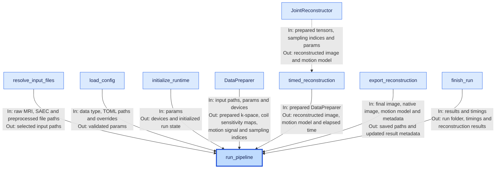
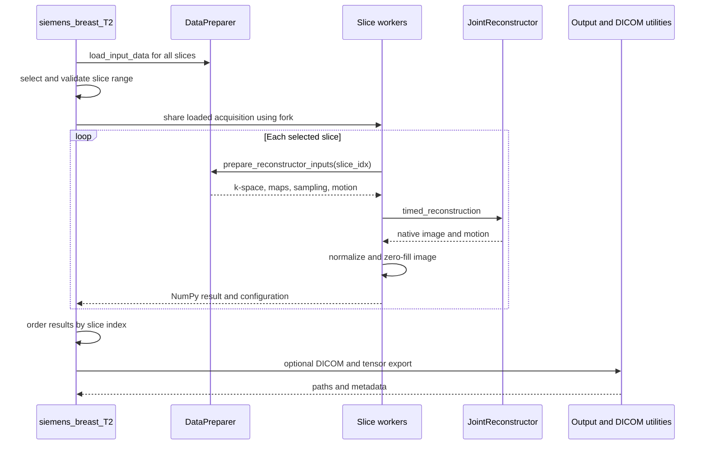
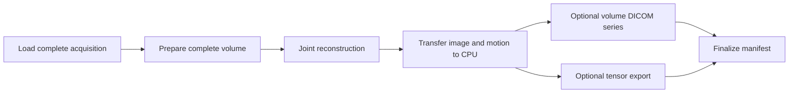

# Pipeline architecture

`siemens_breast_T2.py` and `siemens_breast_3d_lowres.py` coordinate the shared
components in `src/`. Helpers used only by these entry points live in
`pipelines/utils/`.

## System interaction

Arrow labels describe the source component's inputs and outputs.
`run_pipeline` passes data between components; the dotted edge denotes the
solver call inside `timed_reconstruction`. Workflow-specific postprocessing and
optional DICOM export appear in the flows below.

## Shared boundaries

`pipelines/utils/inputs.py` owns file selection. An existing preprocessed file
takes precedence; when it is absent, the pipeline announces its use of raw MRI
and SAEC inputs. Publishing a preprocessing cache is atomic and does not
overwrite an existing destination.

`pipelines/utils/execution.py` adapts prepared data to the solver and output
system. Pipeline-owned runtime overrides take precedence over caller values.
`@managed_execution` surrounds the run to finalize success or failure and
release registered resources.

See [configuration](configuration.md), [input loading](input_data_loading.md),
and [data preparation](data_preparation.md) for those components' boundaries.

## 2D T2 pipeline

Each worker copies `DataPreparer` and `params`, selects its own slice, and binds
separate output paths while retaining the shared loaded acquisition. CPU
workers can use fork; CUDA execution requires one worker.

NumPy result transport avoids PyTorch shared-memory lifetime issues. Final
exports occur only after all selected slices succeed.

## 3D low-resolution pipeline

The complete volume stays active in one process. This path has no separate
postprocessing configuration or zero-filling step, so the exported and native
images refer to the same solver result.

Output names, flags, and cache lifetime are documented in the
[README](../../Readme.md#outputs).
