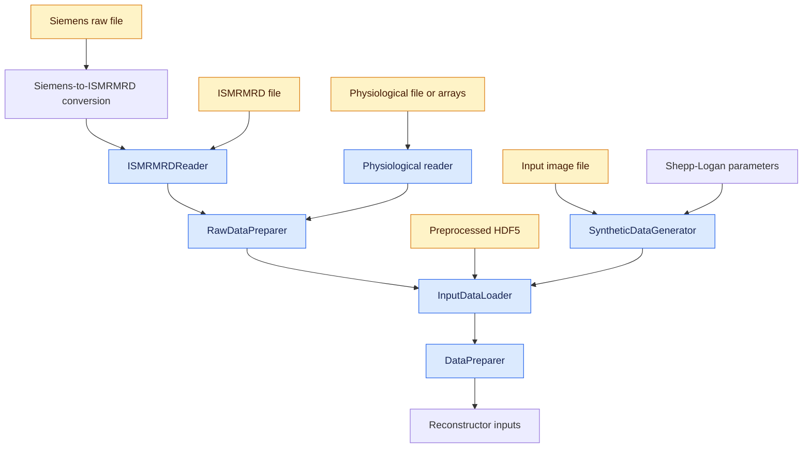

# Preprocessing architecture

The preprocessing pipeline turns synthetic, preprocessed, ISMRMRD, or Siemens
input into one reconstruction-ready 2D slice or 3D volume. The classes are split
by processing stage so that file-format handling, acquisition preparation, slice
selection, and reconstruction preparation each have one owner.

## Data flow



Blue nodes are Python classes. Amber nodes are input files. Uncolored nodes are
parameters, processing steps, or outputs.

For recorded data with `kspace_sampling_type = "from-data"`,
`RawDataPreparer` synchronizes physiological signals with the recorded MRI
readouts. For a resampled workflow, `InputDataLoader` reads the MRI acquisition
without physiology and generates a new sampling order.

## Responsibilities

### `ISMRMRDReader`

`ISMRMRDReader` owns ISMRMRD-specific decoding. It:

- reads the XML header and imaging acquisitions;
- excludes noise and non-imaging acquisitions;
- maps acquisitions into k-space tensors;
- extracts timestamps, sampling indices, geometry, and calibration data; and
- removes readout oversampling from imaging and reference k-space.

It does not read physiological data, synchronize motion signals, select a 2D
slice, or prepare reconstruction inputs.

### Physiological readers

Each physiological reader owns one sensor format. It reads and filters the
sensor data, defines its synchronization policy, selects relevant channels, and
provides format-specific cache parameters. The supported implementations include
SAEC, Polaris, physiological text, and physiological NumPy arrays.

Physiological readers do not read MRI data or perform MRI-to-sensor time
alignment themselves.

### `RawDataPreparer`

`RawDataPreparer` combines the complete decoded MRI acquisition with a configured
physiological reader. It:

- aligns physiological signals with MRI readout timestamps;
- normalizes the aligned signals;
- groups motion and sampling metadata by slice for 2D acquisitions;
- preserves readout ordering for 3D acquisitions; and
- optionally caches the complete synchronized result.

It always returns the complete acquisition. It does not choose the slice used
for reconstruction.

### `SyntheticDataGenerator`

`SyntheticDataGenerator` creates k-space, coil sensitivity maps, and sampling
indices from a Shepp-Logan phantom or an input image. Its output follows the same
loader-facing interface as recorded data.

### `InputDataLoader`

`InputDataLoader` selects the appropriate source path and presents a common
tensor interface to downstream preprocessing. It:

- routes synthetic, preprocessed, ISMRMRD, and Siemens inputs;
- converts NumPy arrays to tensors on the requested device;
- keeps every slice of a 2D multi-slice acquisition available;
- activates and prepares one 2D slice at a time;
- keeps the complete volume active for 3D data; and
- prepares sampling indices and motion metadata for the selected input.

The `_input_*` attributes retain the complete loaded acquisition. The public
working attributes, such as `kspace`, `motion_data`, and `ky_idx`, describe the
currently active slice or volume.

### `DataPreparer`

`DataPreparer` transforms the active loader output into reconstructor inputs. It
validates the input, normalizes k-space, estimates coil sensitivity maps, imports
or simulates motion, bins samples into motion states, and prepares diagnostic
output. It may replace its working k-space without changing the complete input
stored by `InputDataLoader`.

## Main data shapes

K-space uses the common shape:

```text
[coil, repetition, x, y, z]
```

For a complete 2D multi-slice acquisition prepared from recorded sampling:

```text
motion_data: [slice, readout, sensor]
idx_ky:      [slice, readout]
idx_kz:      [slice, readout]
idx_nex:     [slice, readout]
```

After `InputDataLoader` activates one 2D slice:

```text
kspace:      [coil, repetition, x, y, 1]
motion_data: [readout, sensor]
ky_idx:      [readout]
nex_idx:     [readout]
kz_idx:      None
```

For a 3D acquisition, the full `z` dimension remains active and the recorded
`ky`, `kz`, and repetition indices are flattened into chronological readout
vectors.

## Lifecycle

`DataPreparer.load_input_data()` loads or generates the complete input once.
`DataPreparer.prepare_reconstructor_inputs()` then selects the requested 2D
slice, or uses the complete 3D volume, and performs reconstruction-specific
preparation. Multi-slice pipelines can therefore reuse one loaded acquisition
without reading the source files again for each slice.

## Extension rules

When adding an input format, keep format parsing in a reader or a small I/O
module. Return the common acquisition fields to `InputDataLoader` rather than
adding format-specific reconstruction logic.

When adding a physiological format, implement the same reader behavior used by
the existing physiological readers: channel loading, motion preparation,
synchronization policy, source-file enumeration, metadata, and cache parameters.
`RawDataPreparer` should remain independent of individual sensor formats.
