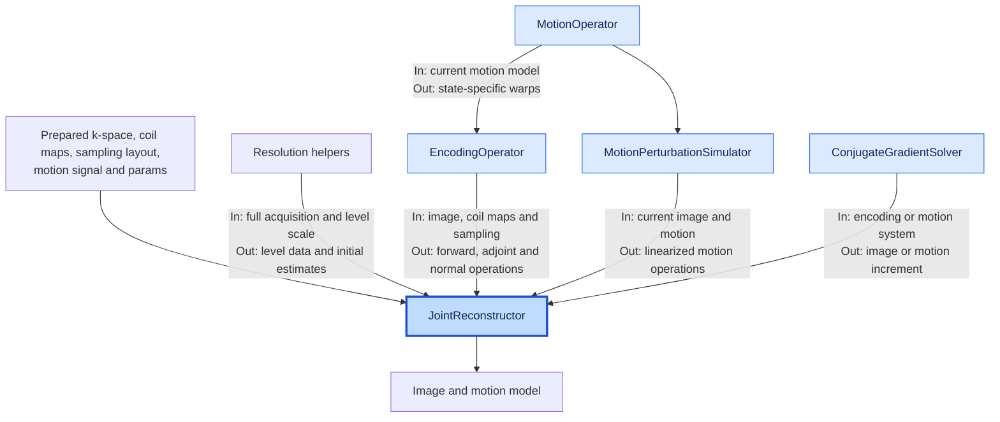

# Reconstruction architecture

`JointReconstructor` owns the multi-resolution image and motion solve for one
prepared slice or volume. Its input contract comes from
[data preparation](data_preparation.md); notebook and pipeline usage is in the
[README](../../Readme.md#standard-reconstruction-entry-point).

## Data flow

Blue nodes are Python classes; the darker node coordinates reconstruction.
Uncolored nodes are inputs, helpers, or outputs. `In` and `Out` describe each
component's contract. `JointReconstructor` builds and connects the operators;
it owns the reconstruction state and iteration policy.

## Solver state

The full-resolution acquisition stays in `Data_full`. Each resolution has its
own cropped k-space, resized coil maps, remapped sampling indices, and image
and motion estimates. Non-rigid reconstruction may reduce motion states at
coarser levels. The next level receives only the preceding image and motion
estimates; temporary operators are released.

Within a Gauss–Newton iteration, fixed motion defines the encoding operator
for the image solve. The updated image produces a k-space residual, which the
motion Jacobian uses to solve for an increment. Rigid motion penalizes increment
magnitude; non-rigid motion penalizes spatial variation of the updated field
and can use a motion preconditioner.

`JointReconstructor` owns iteration counts, final-motion-update policy, and
early stopping. The logger records progress but does not choose updates.

## Optional path and output boundary

Calibration-weighted reconstruction changes the image variable to `x = C p`,
where `C` is the calibration magnitude supplied by preparation. This changes
the image encoding and regularization, not the motion solve. Voxel-aware
regularization scaling requires encoded voxel spacing from the caller.

`run()` returns the image and motion model; the caller owns postprocessing and
final export. The README describes [output files](../../Readme.md#outputs) and
[integration entry points](../../Readme.md#external-integration-apis).
