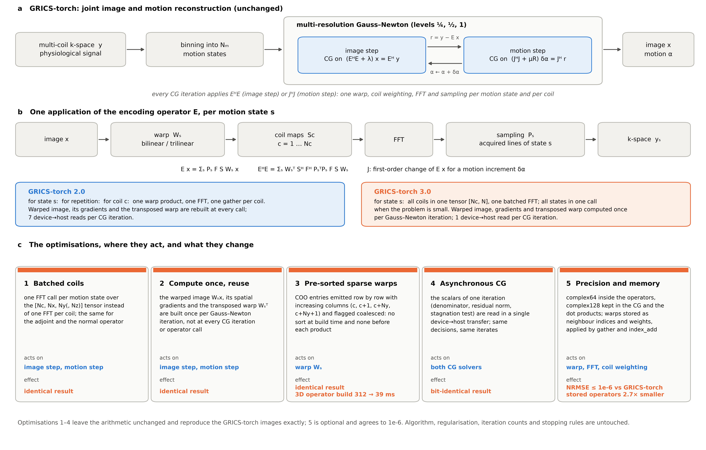
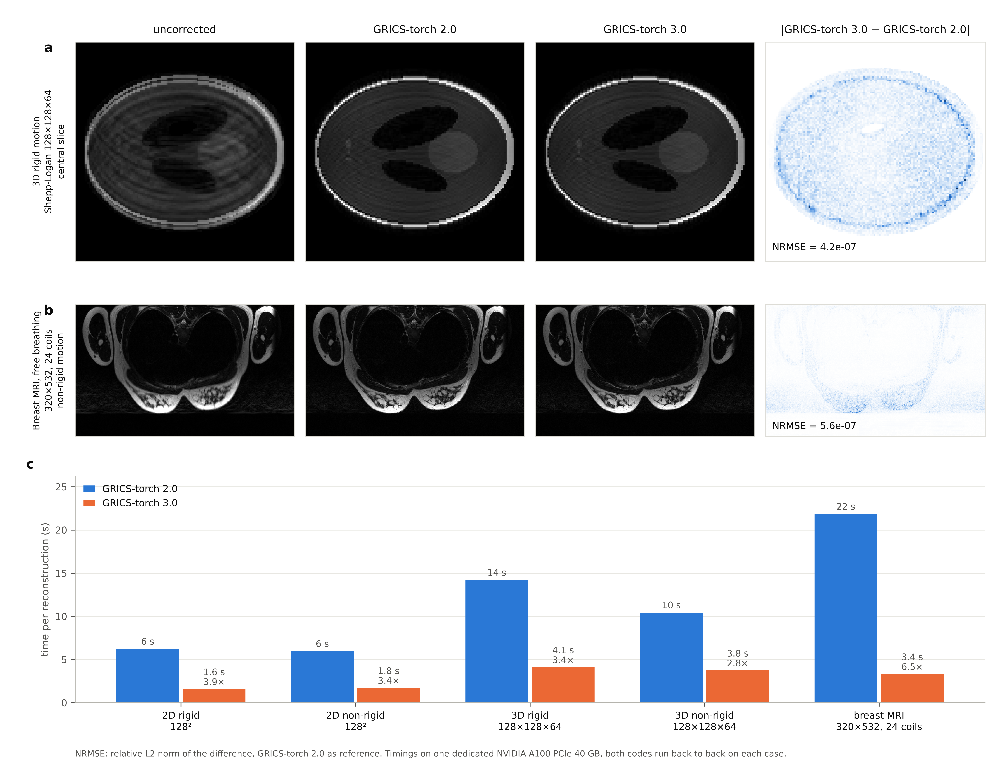

# GRICS-torch 3.0: performance

GRICS-torch 3.0 is based on GRICS-torch 2.0. The three commits on top of it leave the algorithm, the regularisation, the damping, the iteration counts, the early stopping and the CG stopping rules untouched; they change how the operators and the solver use the GPU. Everything below was measured on a dedicated NVIDIA A100 PCIe 40 GB (the GPU of the JOSS paper); the raw outputs are in `benchmarks/results/a100_pcie_40gb_2026-11-13/` and the procedure in `benchmarks/README.md`.

## 1. What changed

The numbers in this document were measured with the performance changes alone (the first three 3.0 commits). The solver corrections of `docs/fixes.md` came later and are on by default; `jacobian_rotation_factor = false`, `motion_step_real = false` and `warm_start_rescale = false` in the reconstruction TOML give the GRICS-torch 2.0 numerics back, and that is the setting the identity figures below refer to.

**Batched operators, same arithmetic (the first 3.0 commit).** Relative differences to GRICS-torch 2.0 4e-16, i.e. summation order only.

1. The coil axis is one batched tensor: one FFT call per motion state instead of one per coil, in the forward, adjoint and normal operators.
2. The warped image of a state and, in the Jacobian, its spatial gradients are computed once per Gauss-Newton iteration and reused for every repetition and every CG iteration; GRICS-torch 2.0 recomputed them inside the repetition loop and at every call. Constant derivative fields of the rigid Jacobian are cached per state.
3. The adjoint warp uses a transposed sparse operator built once per Gauss-Newton iteration; GRICS-torch 2.0 called `.coalesce().transpose(0, 1)` at every call.
4. Contributions of all repetitions are summed before the (linear) adjoint warp and adjoint Jacobian.
5. Both sparse builders emit the COO entries sorted by (row, column) and flag them coalesced: no sort at build time (3D operator build 312 -> 39 ms on an RTX PRO 6000, 86 -> 24 ms on the A100) and none before each product. GRICS-torch 2.0 left the 2D matrix uncoalesced, which makes every product sort it.

**Optional single precision, gather backend, state batching.** Two new keys in the reconstruction TOML; the defaults keep the behaviour above exactly.

- `compute_precision = "single"` (default `"double"`): warps, coil maps and FFTs run in complex64 inside the operators; inputs are cast on entry and outputs returned in complex128, so the CG solver, the dot products and the motion parameters stay in double. Relative difference of operator outputs: 3e-7; of reconstructed images: 2e-7 to 1e-6.
- `warp_backend = "gather"` (default `"sparse"`): each state stores its neighbour indices `[K, N]` and weights `[K, N]` (K = 4 in 2D, 8 in 3D) and applies the warp as a gather and its adjoint as an `index_add_`. Same arithmetic as the sparse product (4e-16), no transposed copies, stored operators 2.7x smaller than the complex128 COO matrices (2048 -> 768 MiB for 8 states at 128x128x64; 8064 -> 3024 MiB at 192x192x56 with 16 states). Code that asks for a matrix gets a lazily materialised sparse view.
- In double precision the gather backend is slower than the pre-sorted sparse default in 3D (its adjoint is an `index_add_` on complex128 values: 4.85 versus 4.49 s on the 3D rigid validation case on the A100, 3.05 versus 2.69 s on an RTX PRO 6000), so it is meant to be combined with `compute_precision = "single"`, where it wins (timings of both GPUs in `benchmarks/results/*/recon_timings`).
- With the gather backend, all motion states of a call go through one gather, one batched FFT over states x coils, one mask multiply and one `index_add_`, chunked under a memory budget (`GRICS_STATE_BATCH_BUDGET_GB`, default 2). It pays off on launch-bound problems and costs memory traffic on large ones, so it is on by default only when a state has at most 2^19 voxels (`GRICS_STATE_BATCH=auto|1|0`, `GRICS_STATE_BATCH_MAX_VOXELS`).

**Asynchronous CG.** `ConjugateGradientSolver.cg` keeps the identical iteration, stopping rules and candidate selection, but reads the scalars of one iteration (denominators, residual norms, stagnation test) in a single device-to-host transfer instead of seven synchronisations. Reconstructions are bit-identical (relative difference 0.0 on the four synthetic validation cases).

## 2. Operator calls (A100, ms per call, mean of 5 after warm-up)

Columns: GRICS-torch 2.0; batched operators in double precision (the first 3.0 commit; the operators of the default settings of GRICS-torch 3.0); GRICS-torch 3.0 with `single` + `gather`. Identity = max relative difference of the operator outputs with respect to GRICS-torch 2.0 over all operators of the case.

**2D rigid, 128x128, 8 coils, 8 states** (identity 3.0e-16 / 2.1e-7)

| operator | GRICS-torch 2.0 | batched, double | batched, single + gather |
|---|---|---|---|
| E forward | 11.6 | 2.1 (5.5x) | 0.5 (22x) |
| E adjoint | 17.8 | 2.5 (7.1x) | 0.6 (31x) |
| E normal | 18.8 | 3.2 (5.9x) | 0.4 (49x) |
| J forward | 15.9 | 2.3 (6.8x) | 1.6 (10x) |
| J adjoint | 19.0 | 3.2 (6.0x) | 2.0 (9.7x) |
| J normal | 34.0 | 5.5 (6.2x) | 3.5 (9.7x) |

**2D non-rigid, 128x128, 8 coils, 8 states** (identity 2.0e-16 / 2.7e-7)

| operator | GRICS-torch 2.0 | batched, double | batched, single + gather |
|---|---|---|---|
| E forward | 10.9 | 2.1 (5.3x) | 0.5 (21x) |
| E adjoint | 16.3 | 2.5 (6.6x) | 0.6 (28x) |
| E normal | 18.6 | 3.2 (5.8x) | 0.4 (49x) |
| J forward | 13.7 | 1.9 (7.1x) | 0.7 (20x) |
| J adjoint | 17.1 | 2.6 (6.6x) | 0.7 (23x) |
| J normal | 30.8 | 4.5 (6.8x) | 1.4 (22x) |

**3D rigid, 128x128x64, 4 coils, 8 states** (identity 0.0 / 2.8e-7)

| operator | GRICS-torch 2.0 | batched, double | batched, single + gather |
|---|---|---|---|
| E forward | 11.3 | 13.7 (0.8x) | 7.9 (1.4x) |
| E adjoint | 87.3 | 15.7 (5.5x) | 8.7 (10x) |
| E normal | 93.3 | 24.0 (3.9x) | 13.6 (6.9x) |
| J forward | 28.9 | 18.7 (1.5x) | 13.8 (2.1x) |
| J adjoint | 32.5 | 22.0 (1.5x) | 14.8 (2.2x) |
| J normal | 61.3 | 40.7 (1.5x) | 28.5 (2.1x) |
| MotionOperator build | 86.5 | 23.8 (3.6x) | 15.1 (5.7x) |

In 3D the forward operator was already a single batched pass GRICS-torch 2.0, so batching does not help it; the gain comes from the adjoint (no transposed copy and no sort per call) and from the Jacobian caching.

## 3. Full reconstructions (A100, seconds for `run()`, same seed)

Shipped synthetic validation settings (Shepp-Logan 128x128 or 128x128x64, simulated motion) and the Zenodo breast slice (320x532, 24 coils, non-rigid). Relative image difference with respect to GRICS-torch 2.0 in brackets.

| case | GRICS-torch 2.0 | batched operators, double (first 3.0 commit) | GRICS-torch 3.0, double + gather | GRICS-torch 3.0, single + gather |
|---|---|---|---|---|
| 2D rigid | 6.2 | 2.0 (3.0x, 0.0) | 1.5 (4.1x, 8e-15) | 1.6 (3.9x, 1e-6) |
| 2D non-rigid | 6.0 | 2.2 (2.7x, 0.0) | 1.7 (3.4x, 1e-15) | 1.8 (3.4x, 3e-7) |
| 3D rigid | 14.2 | 4.5 (3.2x, 0.0) | 4.9 (2.9x, 2e-15) | 4.1 (3.4x, 4e-7) |
| 3D non-rigid | 10.4 | 4.2 (2.5x, 0.0) | 4.8 (2.2x, 7e-16) | 3.8 (2.8x, 2e-7) |
| breast slice | 21.8 | 4.2 (5.2x, 3e-15) | 4.0 (5.5x, 3e-15) | 3.4 (6.5x, 6e-7) |

Zenodo breast slice with the paper's `nonrigid_2d.toml` (4 motion states), three repeats of `run()`: GRICS-torch 2.0 21.5 / 20.8 / 20.8 s (peak 0.7 GiB); batched double 4.1 / 3.4 / 3.3 s (1.1 GiB); single + gather 3.2 / 2.4 / 2.4 s (1.4 GiB), i.e. 6.1x and 8.7x on the steady-state repeats.

## 4. Where the remaining time goes (roofline model)

`benchmarks/roofline.py` measures the device ceilings (A100: copy bandwidth 1392 GB/s, matmul 18.2 TFLOPS FP32 and 15.1 TFLOPS FP64, 3D FFT of 4 x 128x128x64 complex64 in 0.21 ms) and counts the bytes each operator call must move in the batched formulation (one read and one write per elementwise pass, gather traffic for the warp, one read and one write per FFT). The ratio of that bandwidth-bound time to the measured time is the fraction of the roofline reached:

| problem | operator | GRICS-torch 2.0 | batched, double | batched, single + gather |
|---|---|---|---|---|
| 2D 128x128, 8 coils, 8 states | E normal | 1 % | 5 % | 20 % |
| 2D 320x532, 24 coils, 4 states | E normal | 8 % | 27 % | 35 % |
| 3D 128x128x64, 4 coils, 8 states | E normal | 8 % | 31 % | 30 % |
| 3D 192x192x56, 24 coils, 16 states | E normal | 14 % | 27 % | 26 % |
| 3D 192x192x56, 24 coils, 16 states | J forward | 18 % | 20 % | 18 % |

Small 2D problems are launch-bound: a 128x128 operator call moves less than 0.2 ms worth of data, so the time is kernel launches and host synchronisations, which is what the batching and the asynchronous CG remove. At the paper's 3D size class the batched code reaches about a quarter of the bandwidth bound; the Jacobian operators are the next target.

A second run of `benchmarks/run_all.sh` on an idle NVIDIA RTX PRO 6000 Blackwell (fiber, 2026-11-13) is in `benchmarks/results/rtx_pro_6000_blackwell_2026-11-13/summary.md`: same identities (3.6e-16 double, 2.9e-7 single), default settings 2.0 to 4.1x faster than GRICS-torch 2.0, single + gather 3.1 to 4.7x, Zenodo slice with the paper's config 11.8 -> 2.4 -> 1.8 s.

## 5. Caveats

- All timings are on one dedicated A100 PCIe 40 GB; on a shared GPU the GRICS-torch 2.0 code, with its seven host synchronisations per CG iteration, slows down more than the batched one, so speed-ups measured there are larger and not comparable.
- The simulation path keeps its own complex128 sparse operators; only the reconstruction operators changed.
- The default settings cache a transposed sparse operator per motion state (the first 3.0 commit), so their stored operators take twice the memory of GRICS-torch 2.0's: at 256×208×160 with 8 states and 4 coils this exceeds 40 GB on an A100, where the gather backend (2.7x smaller than GRICS-torch 2.0, no transposed copy) runs.
- `compute_precision = "single"` is an opt-in: the images differ from the double-precision ones by 2e-7 to 1e-6 in relative norm, far below the 1e-4 acceptance threshold used in `benchmarks/compare_recons.py`, but not zero.
