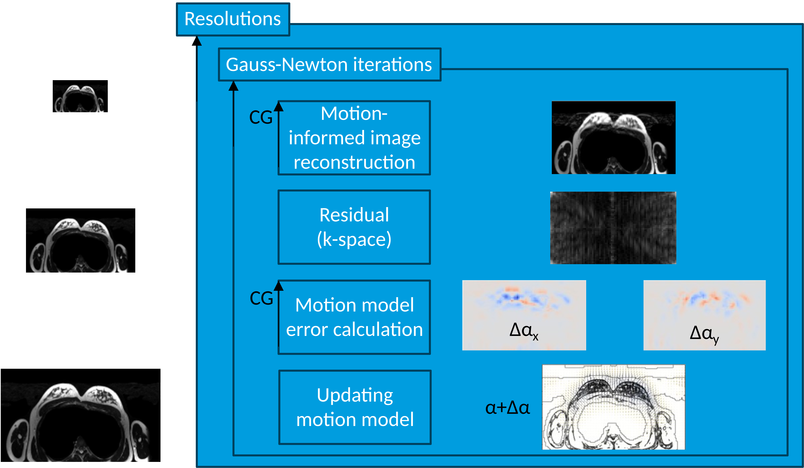

# Summary

`GRICS-torch` is software for motion-corrected MRI reconstruction. Its core is the previously validated GRICS algorithm [@odille2008grics], implemented in PyTorch [@paszke2019pytorch]. It supports 2D and 3D rigid and non-rigid MRI motion correction. The input data can be loaded from common data formats or generated using integrated sampling and motion simulators. After reconstruction, `GRICS-torch` outputs a motion-corrected MRI image, optionally in the DICOM format, and the estimated motion model.

# Statement of need

MRI acquisitions can require relatively long measurement times, making the acquired data sensitive to subject motion. The most common sources of motion include physiological non-rigid motion (e.g., respiratory and cardiac motion) and head motion. Motion occurring during an acquisition introduces inconsistencies between acquired samples and may result in artifacts such as blurring, ghosting, and loss of anatomical detail [@zaitsev2015motion].

To address this problem, numerous motion-corrected MRI reconstruction algorithms have been developed. However, many currently available non-rigid methods rely on the reconstruction of motion-resolved images. In cases of relatively small motion and in the absence of oversampling, this approach may fail. In contrast, the Generalized Reconstruction by Inversion of Coupled Systems (GRICS) algorithm [@odille2008grics] jointly estimates both the motion-corrected image and the motion model.

Despite being extensively used internally for correcting non-rigid [@odille2010cine; @vuissoz2012cine; @fayad2015petmr; @odille2018cine3d; @isaieva2023; @isaieva2025] and rigid motion [@zeroual2024performance], the historical C++ implementation of GRICS remained in-house and required additional pre- and post-processing scripts. Its recent application in studies conducted in collaboration with other teams [@nohava2024breast; @gnanago2025torso; @witte2026grics] has demonstrated interest in the GRICS algorithm beyond its original laboratory.  Additionally, the continued involvement of former team members (now at other institutions) required the simplification of collaborative development. These considerations motivated the creation of an open, self-contained, and maintainable implementation of this algorithm, and `GRICS-torch` fills this gap.

# State of the field

A large number of retrospective and prospective motion-correction strategies have been proposed, several of which are available as open-source implementations.

For applications such as brain MRI, motion can often be approximated as rigid. Three-dimensional rigid motion is described by only six degrees of freedom, which makes it possible to estimate motion parameters jointly with the image reconstruction. Examples of openly available rigid motion-correction algorithms are TAMER [@haskell2018tamer] and DISORDER [@corderogrande2020disorder].

Non-rigid physiological motion is more challenging since the deformation field contains many more degrees of freedom. A common strategy exploits the quasi-periodic nature of physiological motion, which allows for motion binning. If the input data allow, a set of motion-resolved images (i.e., images corresponding to each of the motion bins) can be reconstructed. The motion model can then be estimated from these images using optical flow or other methods, and motion-compensated images can therefore be obtained by incorporating the estimated motion field into the forward MRI encoding operator. An open-source implementation of this approach is included in the BART MRI reconstruction toolbox [@uecker2015bart]. Other openly available implementations include XD-GRASP [@feng2016xdgrasp], iMoCo [@zhu2020imoco], MostMoCo [@ding2022mostmoco], and MoCoLoR [@tan2023mocolor].

However, in many cases, the reconstruction of good-quality motion-resolved images can itself be extremely challenging. An alternative strategy is thus to estimate the motion model directly from the acquired data. MR-MOTUS [@huttinga2020mrmotus] estimates non-rigid motion directly from k-space data but relies on a previously reconstructed reference image. Another strategy is to estimate the motion model jointly with the motion-corrected image by alternating optimization problems, as in GRICS. However, no open-source implementations of this strategy were previously available.

# Software design

The code was developed using PyTorch with CUDA [@nickolls2008cuda] support. `GRICS-torch` separates data preparation, physical operators, numerical optimization, and experiment configuration. In order to facilitate this separation, an object-oriented architecture was selected for this project. Configuration is organized into TOML files covering runtime settings, reconstruction parameters, simulation, and other options. The project also provides image export utilities and a Docker-based environment. Its full documentation is available at [`GRICS-torch` documentation](https://github.com/IADI-Nancy/GRICS-torch/tree/main/docs).

## The GRICS algorithm and the related code

GRICS is a multiresolution optimization algorithm that performs several Gauss-Newton (GN) iterations at each resolution level. Each GN iteration alternates between image reconstruction and motion-model estimation steps, solved using the conjugate gradient (CG) method (\autoref{fig:GRICS_algo}). The method requires MRI k-space data and synchronized physiological surrogate data. A detailed description of the algorithm can be found in the original article [@odille2008grics] or in the [dedicated part](https://github.com/IADI-Nancy/GRICS-torch/blob/main/docs/algorithm.md) of the `GRICS-torch` documentation.
 

{#fig:GRICS_algo}

The GRICS algorithm is implemented in the `reconstruction/JointReconstructor` class. We made an effort to separate the core of the algorithm from the logging/plotting part to make the algorithm more readable. The forward and adjoint MRI encoding operators, motion perturbation operators, and motion operator are implemented in dedicated classes. The conjugate gradient solver was reimplemented to operate directly on PyTorch tensors with matrix-free representations of the encoding and motion perturbation operators. The normal encoding operator was optimized by eliminating the forward and inverse Fourier transforms along the fully sampled readout direction.

At the time of publication, it supports only Cartesian sampling trajectories.

## GPU optimizations

GRICS-torch repeatedly applies the MRI encoding operator $E$ and its adjoint $E^H$ during CG reconstruction. For each motion state, we replaced the separate fast Fourier transform (FFT) calls for individual receive coils with one batched call across all coils (\autoref{fig:gpu}a). We sorted each sparse motion-interpolation matrix $W_t$ by output voxel (\autoref{fig:gpu}b) and cached its adjoint $W_t^H$ for reuse while the motion estimate remains fixed (\autoref{fig:gpu}c). We also grouped the scalar values needed for CG convergence and numerical stability checks into a single device-to-host transfer per ordinary iteration (\autoref{fig:gpu}d). This configuration retains double-precision complex arithmetic.

![Schematic GPU timelines of the optimizations, not to scale. Upper rows: coil-sequential implementation; lower rows: batched implementation. Blocks are GPU kernels; the warp product is the multiplication by $W_t$ or $W_t^H$. (a) For each motion state $t$, the warped image $W_t x$ is weighted by the coil sensitivities and Fourier transformed, coil by coil ($N_c = 4$ FFT calls) or for all coils at once (one call on the stacked coil images). (b) Entries of $W_t$ stored neighbour by neighbour must be sorted by row before every product; stored row by row, they are used directly. (c) The adjoint $W_t^H$ is formed (transposed and sorted) once per Gauss-Newton iteration instead of in every CG iteration. (d) The scalars of a CG iteration are read by the host in one transfer instead of seven; each read stalls the GPU until the next kernels are launched.](figures/gpu_optimizations.png){#fig:gpu}

The optional gather backend stores neighbour indices and interpolation weights for each output voxel (four neighbours in 2D, eight in 3D). The forward operation gathers weighted voxel values, and the adjoint accumulates contributions at the same indices. The gather backend supports batching across motion states, with configurable batching thresholds and memory limits. In the single precision + gather configuration, warps, coil sensitivities and FFTs use complex64, while CG scalars and motion parameters remain in double precision. 

Benchmark methods, performance measurements, and numerical accuracy results are reported in the [GPU optimization validation study](https://github.com/IADI-Nancy/GRICS-torch/blob/main/validation_studies/gpu_optimization_benchmarks.md).

## Data preparation

Data preparation converts real or synthetic MRI data into a common representation for reconstruction. Format-specific readers handle data load. Separate classes perform physiological synchronization, coil sensitivity estimation, optional motion simulation, and motion binning. Therefore, adding a new data format requires only a dedicated reader and minor configuration changes, without major modifications to the other classes. MRI data read is separated from slice or volume preparation, allowing multiple 2D slices to reuse the same loaded data.

Sampling and rigid or non-rigid motion can be simulated to evaluate the reconstruction. Several methods are available for coil sensitivity estimation and motion-state binning. Implementation details and configuration options are described in the [data preparation documentation](https://github.com/IADI-Nancy/GRICS-torch/blob/main/docs/architecture/data_preparation.md).

# Research impact statement

The original GRICS C++ implementation was extensively validated for cardiac MRI [@odille2010cine; @vuissoz2012cine; @odille2015joint; @odille2018cine3d].

One of its current main applications is supine breast MRI. It suffers from respiratory motion of small amplitude, which, however, can significantly degrade image quality [@isaieva2023]. In this context, the GRICS algorithm is currently actively used by the University of Lorraine, France [@isaieva2023; @isaieva2025; @meullenet2023breast; @megel2025breast], as well as by the Medical University of Vienna, Austria [@nohava2024breast; @gnanago2025torso]. There are ongoing projects in these teams that will use the `GRICS-torch` implementation, including a novel hybrid reconstruction algorithm inspired by NLINV-Net [@blumenthal2024nlinvnet] and studies devoted to the use of unconventional motion sensors and their application in clinical populations currently conducted at the Medical University of Vienna. We have also demonstrated that for this application our implementation is at least as performant as the previously validated GRICS++. The details can be found in [Comparison of GRICS-torch with GRICS++](https://github.com/IADI-Nancy/GRICS-torch/blob/main/validation_studies/cpp_pytorch_comparison.md).

Another important application is motion correction in brain MRI at 7T, for which GRICS has been evaluated using rigid and non-rigid motion models [@zeroual2024brain]. The GRICS-torch implementation will extend this work to pediatric MRI cases where motion correction is extremely challenging (article under revision for resubmission to IEEE Acess).

Finally, it can be applied to any other moving organ subjected to periodic physiological motion, such as the lung or liver. 

# AI usage disclosure

We used generative AI tools for code generation, refactoring, and documentation. The main tool was Codex (OpenAI), and the exact version varied depending on the task and date. The level of AI assistance varied across tasks: the algorithmic part of the code was mostly human-written, while configuration parsing was entirely AI-assisted. Some parts of the code were automatically translated from other programming languages. All architectural decisions were made by a human. The code was entirely reviewed by the authors, and numerous tests (available on the main and on the [test branch](https://github.com/IADI-Nancy/GRICS-torch/tree/test/tests)) were performed to ensure its reliability. Additionally, ChatGPT (OpenAI) was used for formatting and grammar checking of the manuscript text.

# Acknowledgements

The authors thank Ziad Al-Haj Hemidi for useful discussions in the early stages of the project and Nora Vogt for providing the sharpness index code. The breast MRI data acquisition was supported by the CIC-IT and CHRU of Nancy and funded by ITMO Cancer of Aviesan within the framework of the 2021-2030 Cancer Control Strategy.

# References
